<div align="center">



<sub><i>Le parcours complet, en quinze secondes : on marche, le compagnon grandit, on croise une borne, on repart avec un objet qu'on ne peut obtenir qu'en y étant allé.</i></sub>

<br><br>


<br>


</div>

---

## 🐋 Le problème

> **Comment réadapter l'homme à son environnement ?**

C'est le sujet imposé de notre SAE. Nous l'avons resserré sur deux maux qui se nourrissent l'un l'autre chez les 18-30 ans urbains : **la sédentarité** et **l'isolement social**.

<table>
<tr>
<td width="50%" valign="top">

### 📉 Ce qui existe déjà
Les applications de santé **mesurent et affichent**. Elles produisent des courbes que personne ne regarde, et l'abandon arrive en quelques semaines. Rien n'attache.

</td>
<td width="50%" valign="top">

### 📱 Et ce qui aggrave
Les réseaux sociaux **remplacent la rencontre** au lieu de la provoquer. On a mille contacts et personne à qui proposer un café à dix minutes de chez soi.

</td>
</tr>
</table>

## 🎯 Notre pari

Un **attachement affectif** fait ce qu'un graphique de pas ne fera jamais. Scubanion est un compagnon virtuel dont la santé dépend entièrement de votre activité réelle : il ne grandit que si vous sortez, et il dépérit si vous restez chez vous.

Et surtout, **l'objet connecté doit envoyer dehors** plutôt que retenir devant l'écran. C'est pour ça que notre seul matériel n'est pas un bracelet de plus : c'est une **borne**, posée dans un musée, un parc ou un restaurant, qui récompense le fait de s'être déplacé jusqu'à elle.

<div align="center">
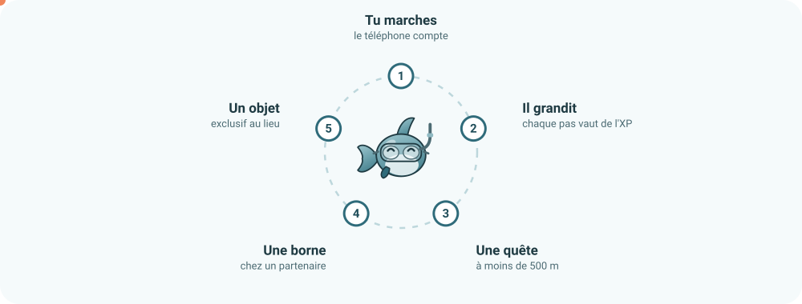
</div>

## 📱 L'application

<div align="center">
</div>

Le téléphone compte les pas tout seul, en fond. L'application s'ouvre **quelques secondes par jour** : le vrai moment de produit, c'est le passage en borne.

## 🗿 La borne

<div align="center">
</div>

### 🔁 Un pivot assumé

Le projet devait lire les pas sur un **bracelet Mi Band 3** en Bluetooth. L'authentification propriétaire du bracelet s'est révélée être un risque lourd sur le chemin critique, pour un bénéfice nul : **un téléphone compte déjà les pas**.

Nous avons donc tout basculé sur le capteur du téléphone, et **concentré l'IoT sur la borne**. Un objet fait à fond plutôt que deux à moitié, et plus rien à acheter pour le joueur.

## 🧩 La chaîne technique

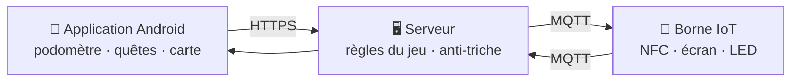

| Brique | Ce qu'elle fait | Stack |
|---|---|---|
| 📱 **Application** | Compte les pas avec le capteur du téléphone, affiche le compagnon, les quêtes géolocalisées, la carte, les amis et les rencontres | Nuxt 4, Vue 3, TypeScript, Capacitor 8 |
| 🖥️ **Serveur** | **Toutes** les règles du jeu : XP, niveaux, validation des quêtes et des passages, garde-fous anti-triche. Abonné MQTT des bornes | Laravel 13, PHP 8.4, MariaDB 11.4 |
| 🗿 **Borne** | Le seul objet que nous concevons : lit le téléphone en NFC, publie le passage, affiche la récompense | Microcontrôleur, lecteur NFC, écran, MQTT |

Rien n'est calculé sur le téléphone. **Un client ment toujours** : les pas sont plafonnés par heure et recoupés avec la position, les quêtes et les passages sont validés côté serveur.

## 💶 Qui paie, et pourquoi

L'application est gratuite et le restera : elle construit l'audience. Ce que nous vendons, c'est **du passage vérifié** : un visiteur présent, pas une impression publicitaire.

| Offre | Prix | Qui paie, et pourquoi |
|---|---:|---|
| Cosmétiques | **1,99 €** | Le joueur attaché à son compagnon. **L'XP ne s'achète jamais.** |
| Abonnement par borne | **49 €/mois** | Le lieu, pour du flux mesurable et une animation clé en main |
| Quête sponsorisée | **300 € + 0,50 €**<br>par passage | Le commerce, parce qu'il ne paie une partie qu'au visiteur effectivement venu |
| Parcours de découverte | **3 000 – 8 000 €** | La collectivité, sur budget sport, santé ou tourisme |
| Programme bien-être | **3 €/mois**<br>par bénéficiaire | L'employeur ou la mutuelle, sur un budget prévention existant |

Pas de publicité, pas de revente de données, pas d'XP achetable. Ce sont trois promesses tenables, et c'est ce qui nous rend vendables à une collectivité.

## 🔬 Des chiffres, pas des impressions

Le prix d'un accessoire n'a pas été décidé en réunion. Nous avons appliqué la **méthode Toolbox Persona** : neuf personnes interrogées individuellement, une échelle de dix prix, deux questions, puis lecture de la zone de chevauchement.

| Ce qu'on a mesuré | Résultat |
|---|---:|
| Personnes interrogées, dont 8 dans la cible | **9** |
| Zone où tout le monde est d'accord | **0,99 € – 1,49 €** |
| Prix retenu, et pourquoi il sort d'un cran | **1,99 €** |
| Au-delà de 4,99 €, personne ne suit | **0 / 8** |

Deux enseignements qu'on ne cherchait pas : **deux personnes sur neuf ne connaissaient pas leur nombre de pas**, le capteur n'étant pas activé sur leur téléphone. Notre promesse repose dessus : l'activation doit devenir une étape guidée. Et la question du prix plancher s'applique mal à un objet purement décoratif, ce qu'un des interrogés nous a fait remarquer à juste titre.

## 🗺️ Où on en est

<div align="center">
</div>

Le point dur est matériel : **la borne n'est pas encore montée**, et elle porte 6 exigences sur 18. C'est écrit noir sur blanc dans notre charte de projet, avec le plan pour la rattraper. Un projet qui cache ses retards ne les rattrape pas.

## 🛠️ Comment on travaille

- **Une branche par tâche**, une PR, et **aucune fusion sans relecture** d'un autre membre.
- **Conventional Commits en français**, parce que l'historique se lit plus souvent qu'il ne s'écrit.
- **Le cahier des charges est la liste de suivi** : 32 exigences numérotées et priorisées *Must / Should / Could*, qu'on coche au fil de l'eau. Chaque décision technique y est reportée avec sa justification.
- **Un point de 30 minutes chaque vendredi** : relevé des indicateurs, tour de table, une décision. Une action non terminée est reportée **avec sa cause écrite**, jamais effacée.
- **Git est noté individuellement**, donc l'équilibre des contributions est un indicateur suivi, et il est publiquement hors cible en ce moment.

## 👥 L'équipe

<div align="center">

<a href="https://github.com/Picsou06">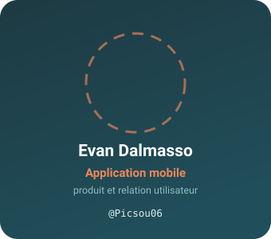</a>
<a href="https://github.com/CodeByHaamza">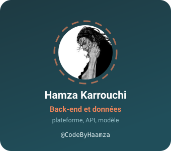</a>
<a href="https://github.com/Tiretinium">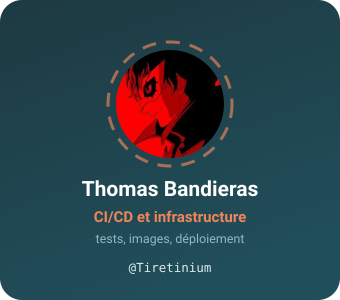</a>
<a href="https://github.com/shalee-pnt">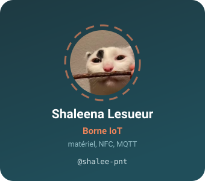</a>

<sub>SAE BUT 3 Informatique · R5.01 management · R5.04 IoT · R5.07 CI/CD · R5.13 économie durable · 2026–2027</sub>

</div>

## 📦 Dépôts

| Dépôt | Contenu |
|---|---|
| [**scubanion**](https://github.com/Scubatana/scubanion) | L'application, l'API, la borne, l'infrastructure, ainsi que toute la documentation du projet dans `docs/` |
| [**.github**](https://github.com/Scubatana/.github) | Cette page, et les scripts qui dessinent ses animations |

```bash
git clone https://github.com/Scubatana/scubanion.git
cd scubanion
cp .env.exemple .env
docker compose -f dev-docker-compose.yml up -d mariadb phpmyadmin
```

<div align="center">
<br>
<sub>Un compagnon qui vous attend à l'intérieur n'a aucun intérêt. 🐋</sub>
</div>
